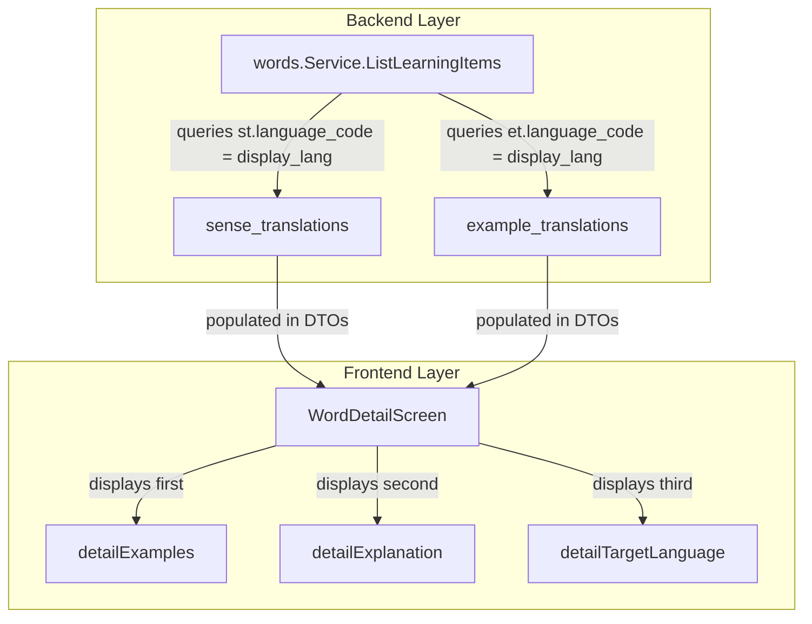

# Word Detail Screen Layout Optimization Implementation Plan

> **For agentic workers:** REQUIRED SUB-SKILL: Use superpowers:subagent-driven-development to implement this plan task-by-task. Steps use checkbox (`- [ ]`) syntax for tracking.

**Goal:** Overhaul the Word Detail Screen layout in the React Native/Expo frontend to show examples first, followed by the target-language definition (explanation), and finally the native/display language translation (labelled as `[Target Language]`). Also resolve a backend query bug that mistakenly joined translation tables on the target language code instead of the display language code.

**Architecture:**
The upgrade consists of three tasks:
1. **Backend Query Fix**: Update `ListLearningItems` and `GetDueReviewItems` in the Go backend service to retrieve and use `defLangCode` (display/native language code) rather than `langCode` (target language code) when querying translations from `sense_translations` and `example_translations`.
2. **Translation Key Additions**: Add `'words.detailExplanation'` and `'words.detailTargetLanguage'` translation keys to English and Korean dictionaries.
3. **Screen Layout Reordering**: Modify the component render sequence in `WordDetailScreen.tsx` to separate explanation and translation and place the examples card at the top.

**Architecture Diagram:**


**Tech Stack:**
- Go (Backend API)
- React Native / Expo (Frontend App)
- TypeScript

## Global Constraints
- Do not introduce any database migrations.
- Maintain compatibility with existing TypeScript types.
- Ensure all backend unit tests pass (`go test ./...`).
- Ensure frontend screen unit tests pass (`jest WordDetailScreen.test.tsx`).

---

## Tasks

### Task 1: Backend Translation Language Resolution Fix

**Files:**
- Modify: `backend/internal/words/service.go`

**Interfaces:**
- `ListLearningItems`: Resolves and uses `defLangCode` for translation table joins.
- `GetDueReviewItems`: Resolves and uses `defLangCode` for translation table joins.

- [ ] **Step 1: Run backend tests to verify current state**
  Run: `GOTOOLCHAIN=go1.26.0 go test ./...` in `backend/`
  Expected: PASS

- [ ] **Step 2: Modify `ListLearningItems` and `GetDueReviewItems` in `backend/internal/words/service.go`**
  Update the sql queries and arguments to map translations to `defLangCode` (mapped to `$3` in the query):
  
  ```diff
  @@ -323,7 +323,8 @@
   	queryLimit := limit + 1
   
   	var err error
  -	params.LanguageCode, _, err = s.fillLangs(ctx, userID, params.LanguageCode, "")
  +	var defLangCode string
  +	params.LanguageCode, defLangCode, err = s.fillLangs(ctx, userID, params.LanguageCode, "")
   	if err != nil {
   		return LearningItemsPage{}, err
   	}
  @@ -338,7 +339,7 @@
   		params.LanguageCode = deck.TargetLanguage
   	}
   
  -	args := []any{userID, params.LanguageCode}
  +	args := []any{userID, params.LanguageCode, defLangCode}
   	deckPredicate := ""
   	if params.DeckID != "" {
   		args = append(args, params.DeckID)
  @@ -373,7 +374,7 @@
   	query := fmt.Sprintf(
   		`select uws.id::text, uws.word_sense_id::text, w.id::text,
   		        w.language_code, w.lemma, w.normalized_text, w.part_of_speech, w.pronunciation,
  -		        $2::text as display_language,
  +		        $3::text as display_language,
   		        ws.definition, ws.short_definition,
   		        coalesce(st.definition, ws.definition),
   		        coalesce(st.short_definition, ws.short_definition),
   		        uws.learning_stage, rs.due_at, uws.added_at,
   		        uws.deck_id::text, d.name, rs.last_reviewed_at
   		 from user_word_senses uws
   		 join word_senses ws on ws.id = uws.word_sense_id
   		 join words w on w.id = ws.word_id
   		 join review_states rs on rs.user_word_sense_id = uws.id
   		 join decks d on d.id = uws.deck_id
   		 left join sense_translations st
  -		   on st.word_sense_id = ws.id and st.language_code = $2
  +		   on st.word_sense_id = ws.id and st.language_code = $3
   		 where uws.user_id = $1::uuid
   		   and w.language_code = $2
   		   and uws.archived_at is null
  @@ -1064,7 +1064,8 @@
   	}
   
   	var err error
  -	langCode, _, err = s.fillLangs(ctx, userID, langCode, "")
  +	var defLangCode string
  +	langCode, defLangCode, err = s.fillLangs(ctx, userID, langCode, "")
   	if err != nil {
   		return nil, err
   	}
  @@ -1119,7 +1120,7 @@
   	}
   
   	deckPredicate := ""
  -	argsBase := []any{userID, langCode}
  +	argsBase := []any{userID, langCode, defLangCode}
   	if deckID != "" {
   		argsBase = append(argsBase, deckID)
   		deckPredicate = fmt.Sprintf("and uws.deck_id = $%d::uuid", len(argsBase))
  @@ -1127,7 +1128,7 @@
   	baseQuery := `
   		select uws.id::text, uws.word_sense_id::text, w.id::text,
   		       w.language_code, w.lemma, w.normalized_text, w.part_of_speech, w.pronunciation,
  -		       $2::text as display_language,
  +		       $3::text as display_language,
   		       ws.definition, ws.short_definition,
   		       coalesce(st.definition, ws.definition),
   		       coalesce(st.short_definition, ws.short_definition),
   		       rs.scheduled_days, rs.remaining_steps,
   		       rs.last_reviewed_at
   		from user_word_senses uws
   		join word_senses ws on ws.id = uws.word_sense_id
   		join words w on w.id = ws.word_id
   		join review_states rs on rs.user_word_sense_id = uws.id
   		left join sense_translations st
  -		  on st.word_sense_id = ws.id and st.language_code = $2
  +		  on st.word_sense_id = ws.id and st.language_code = $3
   		where uws.user_id = $1::uuid
   		  and w.language_code = $2
   ```

- [ ] **Step 3: Run backend unit tests to verify correctness**
  Run: `GOTOOLCHAIN=go1.26.0 go test ./...` in `backend/`
  Expected: PASS

- [ ] **Step 4: Commit changes**
  ```bash
  git add backend/internal/words/service.go
  git commit -m "fix(backend): query translations using display language instead of target language"
  ```

---

### Task 2: Translation Key Additions

**Files:**
- Modify: `frontend/src/i18n/translations.ts`

**Interfaces:**
- Exposes `words.detailExplanation` and `words.detailTargetLanguage` in translation keys.

- [ ] **Step 1: Modify `frontend/src/i18n/translations.ts`**
  Add `'words.detailExplanation'` and `'words.detailTargetLanguage'` translation keys under `en` and `ko` dictionaries:

  ```diff
  @@ -81,6 +81,8 @@
     'words.renameDeck': 'Rename deck',
     'words.detailTitle': 'Word Detail',
     'words.detailDefinition': 'Definition',
  +  'words.detailExplanation': 'Explanation',
  +  'words.detailTargetLanguage': '[Target Language]',
     'words.detailExamples': 'Examples',
     'words.detailAdded': 'Added',
     'words.detailDue': 'Due',
  @@ -382,6 +384,8 @@
     'words.renameDeck': '덱 이름 변경',
     'words.detailTitle': '단어 상세',
     'words.detailDefinition': '정의',
  +  'words.detailExplanation': '설명',
  +  'words.detailTargetLanguage': '[Target Language]',
     'words.detailExamples': '예문',
     'words.detailAdded': '추가일',
  ```

- [ ] **Step 2: Commit changes**
  ```bash
  git add frontend/src/i18n/translations.ts
  git commit -m "style: add translation keys for Explanation and Target Language layout labels"
  ```

---

### Task 3: Screen Layout Reordering

**Files:**
- Modify: `frontend/src/features/words/WordDetailScreen.tsx`
- Test: `frontend/src/features/words/WordDetailScreen.test.tsx`

**Interfaces:**
- `WordDetailScreen` renders components in the new optimized layout hierarchy.

- [ ] **Step 1: Modify `frontend/src/features/words/WordDetailScreen.tsx`**
  Extract `explanation`, `shortExplanation`, `translation`, and `shortTranslation` properties, and order the card outputs dynamically:

  ```diff
  @@ -74,8 +74,10 @@
       [item.id, navigation, t],
     );
   
  -  const definition = item.localized_definition || item.definition;
  -  const shortDefinition = item.localized_short_definition || item.short_definition;
  +  const explanation = item.definition;
  +  const shortExplanation = item.short_definition;
  +  const translation = item.localized_definition;
  +  const shortTranslation = item.localized_short_definition;
     const cefrLabel = item.cefr_level ? `CEFR ${item.cefr_level}` : null;
     const examples = item.examples ?? [];
   
  @@ -107,18 +109,6 @@
             {cefrLabel && <Badge label={cefrLabel} variant="info" />}
           </View>
   
  -        <Card style={{ marginBottom: spacing.md }}>
  -          <Text variant="label" color="muted" style={{ marginBottom: spacing.xs }}>
  -            {t('words.detailDefinition')}
  -          </Text>
  -          <Text variant="body">{definition}</Text>
  -          {shortDefinition && shortDefinition !== definition && (
-            <Text variant="caption" color="muted" style={{ marginTop: spacing.xs }}>
-              {shortDefinition}
-            </Text>
-          )}
-        </Card>
-
           {examples.length > 0 && (
             <Card style={{ marginBottom: spacing.md }}>
               <Text variant="label" color="muted" style={{ marginBottom: spacing.sm }}>
  @@ -148,6 +138,34 @@
             </Card>
           )}
   
  +        {explanation ? (
  +          <Card style={{ marginBottom: spacing.md }}>
  +            <Text variant="label" color="muted" style={{ marginBottom: spacing.xs }}>
  +              {t('words.detailExplanation')}
+            </Text>
+            <Text variant="body">{explanation}</Text>
+            {shortExplanation && shortExplanation !== explanation && (
+              <Text variant="caption" color="muted" style={{ marginTop: spacing.xs }}>
+                {shortExplanation}
+              </Text>
+            )}
+          </Card>
+        ) : null}
+
+        {translation && translation !== explanation ? (
+          <Card style={{ marginBottom: spacing.md }}>
+            <Text variant="label" color="muted" style={{ marginBottom: spacing.xs }}>
+              {t('words.detailTargetLanguage')}
+            </Text>
+            <Text variant="body">{translation}</Text>
+            {shortTranslation && shortTranslation !== translation && shortTranslation !== shortExplanation && (
+              <Text variant="caption" color="muted" style={{ marginTop: spacing.xs }}>
+                {shortTranslation}
+              </Text>
+            )}
+          </Card>
+        ) : null}
+
           <Card>
             <View style={[styles.metaRow, { gap: spacing.sm }]}>
               <Text variant="label" color="muted">
  ```

- [ ] **Step 2: Run frontend unit tests to verify success**
  Run: `npm test src/features/words/WordDetailScreen.test.tsx`
  Expected: PASS

- [ ] **Step 3: Commit changes**
  ```bash
  git add frontend/src/features/words/WordDetailScreen.tsx
  git commit -m "style: reorder WordDetailScreen cards to put examples first followed by explanation and translation"
  ```
