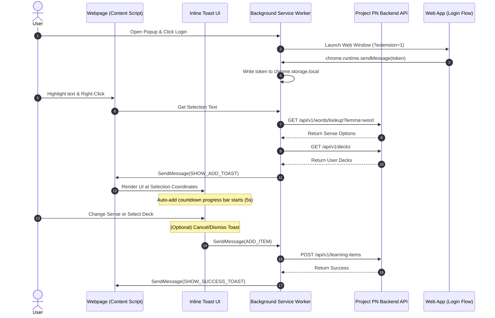

# Design Spec: Browser Extension Word Import

## 1. Overview & Objectives

This document specifies the design for the Project PN Browser Extension. The browser companion extension enables users to highlight any word or phrase on a webpage, right-click, and directly import it into their Project PN learning decks. 

### Success Criteria
- [x] Manifest V3 compliant extension with background service worker architecture.
- [x] Context Menu item: "Add to Project PN" when text is selected.
- [x] Inline Toast UI dynamically rendered next to the selected text with a 5-second auto-add timer progress bar.
- [x] Sense definition lookup and target deck selector dropdowns inside the inline toast.
- [x] Single-Sign-On (SSO) authentication sharing credentials from the primary web application.
- [x] Platform compatibility: Google Chrome, Microsoft Edge, and other Chromium-based browsers.

---

## 2. System Architecture

The browser extension consists of four main modules:

1. **Popup UI (`src/popup/`)**: A clean settings pane to log in, select languages, and set defaults.
2. **Background Service Worker (`src/background.ts`)**: Handles browser context menu events, listens to IPC messages, and makes REST API calls.
3. **Content Script (`src/content.ts`)**: Injected into webpage tabs to read text selections and mount the inline toast.
4. **Inline Toast View (`src/inlineToast.ts`)**: A custom, lightweight HTML/CSS widget rendered inside target webpages with selection coordinate positioning.

---

## 3. Communication & Message Types

All extension modules communicate via asynchronous Chrome Runtime messaging (`chrome.runtime.sendMessage` and `chrome.tabs.sendMessage`):

| Message Type | Sender | Receiver | Payload | Description |
|---|---|---|---|---|
| `PING` | Background | Content Script | None | Verifies content script injection |
| `SHOW_ADD_TOAST` | Background | Content Script | `AddToastPayload` | Mounts the inline sense/deck selector toast |
| `SHOW_ERROR_TOAST` | Background | Content Script | `{ message: string }` | Displays an error toast message at bottom |
| `ADD_ITEM` | Content Script | Background | `{ wordSenseId, deckId, displayLanguage }` | Instructs background worker to save the item |
| `PN_EXTENSION_AUTH` | Web App | Background | `{ token, displayLanguage }` | Transmits SSO token upon successful login |

---

## 4. UI/UX Specifications

### Inline Toast Element
- **Positioning**: Absolute coordinates matching the bottom bounding rectangle of the text selection range.
- **Auto-Add Progress Bar**: Displays a thin horizontal progress bar (`scaleX` from 1 to 0) animating across 5 seconds. Timeout automatically triggers the "Add" command.
- **Senses Dropdown**: Displays a clean `<select>` listing the top senses fetched from the API with part of speech and localized definition.
- **Decks Dropdown**: Displays a `<select>` populated with target deck names, pre-selecting the user's default deck.
- **Actions**: "Add" (confirms immediately) and "Cancel" (dismisses toast and halts save).
- **Close Triggers**: Clicking outside the toast, pressing `Escape` key, or clicking "Cancel".

---

## 5. Security & Authentication

- **Token Storage**: Saved securely using `chrome.storage.local` with strict encryption/sandboxing enforced by Chromium.
- **CORS Configuration**: The Project PN backend authorizes requests containing headers matching the extension origin (`chrome-extension://<id>`).
- **Stable ID Generation**: Uses a developer-provided public key (`PN_DEV_EXTENSION_KEY`) in the Manifest file to anchor the extension ID across compiles and avoid configuration resets.
