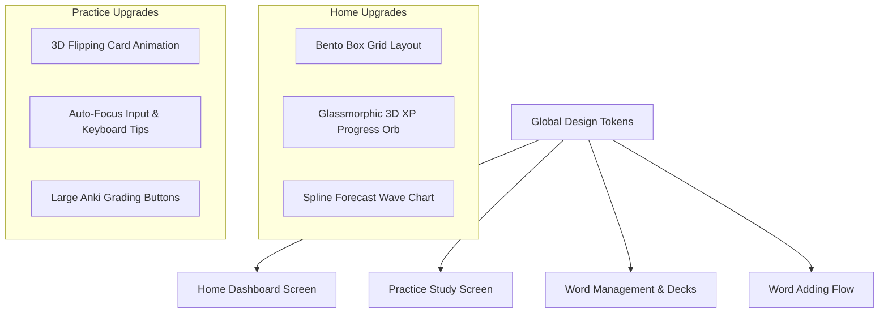

# Design Spec: UI/UX Improvements for Project PN

- **Date**: 2026-07-04
- **Status**: Proposed
- **Author**: Antigravity Code Consultant
- **Target Location**: `docs/superplan/spec/2026-07-04-ui-ux-improvements-design.md`

---

## 1. Executive Summary & Goals

This specification outlines the UI/UX architecture and visual design upgrades for the Project PN vocabulary learning application. Based on high-fidelity variation mockups, this plan focuses on upgrading the app’s aesthetics to a premium, modern experience.

### Primary Goals
- **Establish a premium aesthetic**: Transition to modern visual treatments (glassmorphism, gradient glowing cards, unified shadows, and crisp typography) matching the generated dashboard mockup.
- **Responsive Flexbox Layouts**: Ensure the app renders beautifully across mobile (iOS/Android via Expo) and web/desktop formats (via Tauri / Web builds).
- **Interactive Micro-Animations**: Implement subtle scaling, springs, and progress indicators to make the interface feel responsive and alive.
- **Typing & Practice UX Polish**: Refine the study session layouts, including card flipping animations, inline ratings, and keyboard shortcuts.

---

## 2. Visual Design System & Themes

The core styles in `frontend/src/theme/tokens.ts` will be updated to support premium visual features.

### 2.1 Color Token Enhancements
We will define and implement four design directions as selectable options, defaulting to the approved premium Bento Box Theme in dark mode:

```typescript
// Proposed enhancements to theme tokens (tokens.ts)
export const visualVariations = {
  bentoIndigo: {
    background: '#07070a',
    surface: 'rgba(14, 14, 23, 0.7)',
    border: 'rgba(255, 255, 255, 0.05)',
    primaryGlow: 'rgba(139, 92, 246, 0.15)',
    accentPink: '#ec4899',
    accentPinkGlow: 'rgba(236, 72, 153, 0.25)',
    glassBlur: 24,
  },
  bentoSunset: {
    background: '#0f0a0a',
    surface: 'rgba(25, 18, 18, 0.7)',
    border: 'rgba(245, 158, 11, 0.08)',
    primaryGlow: 'rgba(245, 158, 11, 0.2)',
    accentOrange: '#f97316',
    accentOrangeGlow: 'rgba(249, 115, 22, 0.3)',
    glassBlur: 24,
  },
  bentoLight: {
    background: '#f4f5f7',
    surface: 'rgba(255, 255, 255, 0.72)',
    border: 'rgba(0, 0, 0, 0.04)',
    primaryGlow: 'rgba(59, 130, 246, 0.1)',
    accentPink: '#db2777',
    accentPinkGlow: 'rgba(219, 39, 119, 0.15)',
    glassBlur: 24,
  },
  cyberpunk: {
    background: '#060913',
    surface: 'rgba(20, 30, 55, 0.45)',
    border: 'rgba(255, 255, 255, 0.08)',
    primaryGlow: 'rgba(79, 106, 255, 0.4)',
    accentGlow: 'rgba(0, 255, 204, 0.4)',
    glassBlur: 16,
  },
  minimalist: {
    background: '#0d0d0e',
    surface: '#18181c',
    border: '#27272c',
    primaryGlow: 'transparent',
    accentGlow: 'transparent',
    glassBlur: 0,
  },
  brutalist: {
    background: '#0c0f1d',
    surface: '#19213f',
    border: '#ffffff', // Thick solid white borders (2px)
    shadow: '6px 6px 0px #000000',
  }
};
```

---

## 3. Screen Redesigns & Components

We will perform targeted makeovers on four core views of the frontend application.



### 3.1 Home / Dashboard Screen (`HomeScreen.tsx`)
- **Bento Grid Layout**: Restructure the dashboard container to use a CSS Grid/flexbox-wrapping Bento grid. The grid consists of:
  - **Left Sidebar**: 280px width containing application navigation and a bottom profile summary.
  - **Vertical Hero Card (Review Due)**: Spans 2 grid rows. Renders a glowing background gradient from purple to pink, with the review count ('18') displayed in large bold text and a pill-shaped glowing review button.
  - **Today's XP Progress**: Renders a floating 3D glass orb that rotates slowly using CSS animations, surrounded by an orange progress arc.
  - **Vocabulary Forecast**: Renders a glowing smooth spline wave chart utilizing SVG elements, replacing simple rectangular bars with curved paths.
  - **Learning Journey & Recent Reviews**: Lists recent word updates (e.g., Ephemeral, Ambivalent) with colorful status tags.
  - **Leaderboard**: Displays current ranks with profile avatars and score counts.
- **Card Styling**: Standardize on `Card` components configured with `glass={true}`:
  - Background: `rgba(14, 14, 23, 0.7)`
  - Backdrop Blur: `24px`
  - Border: `1px solid rgba(255, 255, 255, 0.05)`

### 3.2 Practice Study Screen (`PracticeScreen.tsx` & `Flashcard.tsx`)
- **3D Card Flip Animation**: Implement real-time 3D Card Flipping using CSS transform style `preserve-3d` (web) and Animated values mapping to `rotateY` (React Native).
- **Session Modes**:
  - *Typing mode*: Inputs will trigger auto-focus on card load. Pressing "Enter" transitions to the flipped card back view.
  - *Flashcard mode*: Cards can be tapped anywhere on the face to flip.
- **Anki Grading Deck**:
  - Present four distinct rating buttons: Again, Hard, Good, Easy.
  - Render estimated intervals (e.g., `<10m`, `1.2d`, `3.5d`, `7.2d`) directly inside the button frames.
  - Support keyboard shortcuts `1`, `2`, `3`, `4` on web/desktop.

### 3.3 Word Management & Decks (`MyWordsScreen.tsx`)
- Add inline loading indicators to the list header for search queries.
- Optimize deck cards in `DeckList.tsx` and `DeckCanvas.tsx` to use glassmorphic accents.

### 3.4 Word Adding Flow (`CaptureSection.tsx` & `ManualAddSection.tsx`)
- Integrate soft inline validations on input blur, adding descriptive helper texts.
- Ensure the language configs for translations in both English and Korean are populated in `translations.ts`.

---

## 4. Animation & Interaction Specifications

### 4.1 Card Flip Animation Spec (React Native)
We will animate the rotation of the card front and back faces using interpolations of a single anim value:

```typescript
const rotateAnim = useRef(new Animated.Value(0)).current;

const frontInterpolate = rotateAnim.interpolate({
  inputRange: [0, 180],
  outputRange: ['0deg', '180deg'],
});

const backInterpolate = rotateAnim.interpolate({
  inputRange: [0, 180],
  outputRange: ['180deg', '360deg'],
});
```

---

## 5. Implementation Sequence & Milestones

1. **Phase 1: Update Theme & Tokens**: Implement the design tokens (`tokens.ts`) and global styles.
2. **Phase 2: Dashboard Redesign**: Refactor `HomeScreen.tsx` layout grids, card styles, and progress widgets.
3. **Phase 3: Practice & Flippable Card Redesign**: Integrate the flippable card component, rating buttons, and key listener hooks.
4. **Phase 4: Word lists & Add Forms**: Apply soft validations, undo actions, and translation updates.
