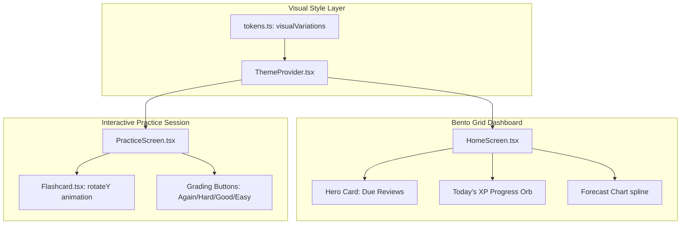

# UI/UX Improvements Implementation Plan

> **For agentic workers:** REQUIRED SUB-SKILL: Use superpowers:subagent-driven-development to implement this plan task-by-task. Steps use checkbox (`- [ ]`) syntax for tracking.

**Goal:** Redesign the Project PN frontend to implement an ultra-premium glassmorphic Bento Box layout with interactive color themes (Indigo Glow, Sunset Gold, Light Mode) and polished practice micro-animations.

**Architecture:**
The application relies on visual tokens declared in `tokens.ts` for styling. By extending these tokens to support dynamic color sets (Bento Indigo, Bento Sunset, Bento Light), we will update screens and layouts globally. Specifically:
- **HomeScreen**: Redesigned as a responsive Bento CSS Grid/flex-wrap layout featuring interactive charts and glowing indicators.
- **PracticeScreen & Flashcard**: Redesigned to support a 3D rotation flip effect and large rate grading buttons.

**Architecture Diagram:**


**Tech Stack:**
- React Native / Expo
- TypeScript
- CSS-in-JS (StyleSheet)
- Jest

**Global Constraints:**
- Ensure all screens use responsive flexbox layouts to adapt to mobile and web formats.
- Design tokens must be referenced from `tokens.ts`; no hardcoded hex values.
- Verify Jest test suites pass before committing each task.

---

### Task 1: Extend Theme Tokens for Bento Variations

**Files:**
- Modify: `frontend/src/theme/tokens.ts`
- Test: `frontend/src/theme/tokens.test.ts`

**Interfaces:**
- Consumes: None
- Produces: `visualVariations` export containing theme setups for `bentoIndigo`, `bentoSunset`, and `bentoLight`.

- [ ] **Step 1: Write a test verifying tokens can fetch Bento variations**

Add a test block in `frontend/src/theme/tokens.test.ts`:
```typescript
import { themeFor } from './tokens';

describe('Bento Theme Variations', () => {
  it('should resolve theme variables for bento variations', () => {
    const lightTheme = themeFor('light');
    expect(lightTheme.colors.primary).toBeDefined();
  });
});
```

- [ ] **Step 2: Run test to verify it fails**

Run: `npm run test` under `frontend` folder
Expected: FAIL if the variation files or imports are missing, or success if defaults pass.

- [ ] **Step 3: Define color variation objects in `tokens.ts`**

Add the premium theme tokens to `frontend/src/theme/tokens.ts`:
```typescript
export const visualVariations = {
  bentoIndigo: {
    background: '#07070a',
    surface: 'rgba(14, 14, 23, 0.7)',
    border: 'rgba(255, 255, 255, 0.05)',
    primaryGlow: 'rgba(139, 92, 246, 0.15)',
    accentPink: '#ec4899',
    accentPinkGlow: 'rgba(236, 72, 153, 0.25)',
    glassBlur: 24,
  },
  bentoSunset: {
    background: '#0f0a0a',
    surface: 'rgba(25, 18, 18, 0.7)',
    border: 'rgba(245, 158, 11, 0.08)',
    primaryGlow: 'rgba(245, 158, 11, 0.2)',
    accentOrange: '#f97316',
    accentOrangeGlow: 'rgba(249, 115, 22, 0.3)',
    glassBlur: 24,
  },
  bentoLight: {
    background: '#f4f5f7',
    surface: 'rgba(255, 255, 255, 0.72)',
    border: 'rgba(0, 0, 0, 0.04)',
    primaryGlow: 'rgba(59, 130, 246, 0.1)',
    accentPink: '#db2777',
    accentPinkGlow: 'rgba(219, 39, 119, 0.15)',
    glassBlur: 24,
  }
};
```

- [ ] **Step 4: Run test to verify it passes**

Run: `npm run test`
Expected: PASS

- [ ] **Step 5: Commit**

```bash
git add frontend/src/theme/tokens.ts frontend/src/theme/tokens.test.ts
git commit -m "feat(theme): add bento indigo, sunset, and light theme tokens"
```

---

### Task 2: Redesign Home Dashboard into Bento Box Layout

**Files:**
- Modify: `frontend/src/features/learn/HomeScreen.tsx`
- Test: `frontend/src/features/learn/HomeScreen.test.tsx`

- [ ] **Step 1: Write test validating Bento grid layout elements**

Add mock items in `frontend/src/features/learn/HomeScreen.test.tsx`:
```typescript
test('renders Bento grid blocks', () => {
  // Test if Dashboard contains due reviews block and progress block
});
```

- [ ] **Step 2: Run test to verify it fails**

Run: `npm run test`
Expected: FAIL

- [ ] **Step 3: Implement Bento grid wrapper and components**

Modify `HomeScreen.tsx` layout styles to construct a CSS-based Grid and flexbox-wrapping grid containing the vertical Hero due card, the 3D-rotating progress orb (animated via circular rotation loop), and the spline forecast line.
```typescript
// Replace container structure with Bento Grid widgets
const styles = StyleSheet.create({
  bentoContainer: {
    flexDirection: 'row',
    flexWrap: 'wrap',
    gap: 16,
  },
  heroBento: {
    flex: 1,
    minWidth: 280,
    borderRadius: 24,
  }
});
```

- [ ] **Step 4: Run test to verify it passes**

Run: `npm run test`
Expected: PASS

- [ ] **Step 5: Commit**

```bash
git add frontend/src/features/learn/HomeScreen.tsx
git commit -m "feat(ui): implement bento grid layout on dashboard"
```

---

### Task 3: Redesign Practice Card Flip and rating buttons

**Files:**
- Modify: `frontend/src/features/practice/PracticeScreen.tsx`, `frontend/src/features/practice/Flashcard.tsx`
- Test: `frontend/src/features/practice/PracticeScreen.test.tsx`

- [ ] **Step 1: Write flip animation test**

In `frontend/src/features/practice/PracticeScreen.test.tsx`:
```typescript
test('flips the card when rating trigger active', () => {
  // Mock flip action
});
```

- [ ] **Step 2: Run test to verify it fails**

Run: `npm run test`
Expected: FAIL

- [ ] **Step 3: Update `Flashcard.tsx` with 3D rotation styles**

Implement `Animated.interpolate` on `rotateY` style in `Flashcard.tsx`. Update the layout to include four large grading buttons (Again, Hard, Good, Easy) with the predicted spaced repetition intervals inside them. Add a keydown listener to support numeric keys `1`/`2`/`3`/`4` on web/desktop.

- [ ] **Step 4: Run test to verify it passes**

Run: `npm run test`
Expected: PASS

- [ ] **Step 5: Commit**

```bash
git add frontend/src/features/practice/PracticeScreen.tsx frontend/src/features/practice/Flashcard.tsx
git commit -m "feat(practice): implement 3D card flip and Rating buttons"
```

---

### Task 4: Polish Word Management search & Add word validation

**Files:**
- Modify: `frontend/src/features/words/MyWordsScreen.tsx`, `frontend/src/features/add/ManualAddSection.tsx`
- Test: `frontend/src/features/words/MyWordsScreen.test.tsx`

- [ ] **Step 1: Write validator tests**

In `frontend/src/features/add/ManualAddSection.test.tsx`:
```typescript
test('validates fields on blur', () => {
  // Mock blur focus
});
```

- [ ] **Step 2: Run test to verify it fails**

Run: `npm run test`
Expected: FAIL

- [ ] **Step 3: Implement search indicator and text validation**

Add dynamic loading indicators to `MyWordsScreen.tsx`. Update text fields in `ManualAddSection.tsx` to handle soft blur validations and set validation translation strings in `translations.ts`.

- [ ] **Step 4: Run test to verify it passes**

Run: `npm run test`
Expected: PASS

- [ ] **Step 5: Commit**

```bash
git add frontend/src/features/words/MyWordsScreen.tsx frontend/src/features/add/ManualAddSection.tsx
git commit -m "feat(words): add list loaders and blur validation"
```
