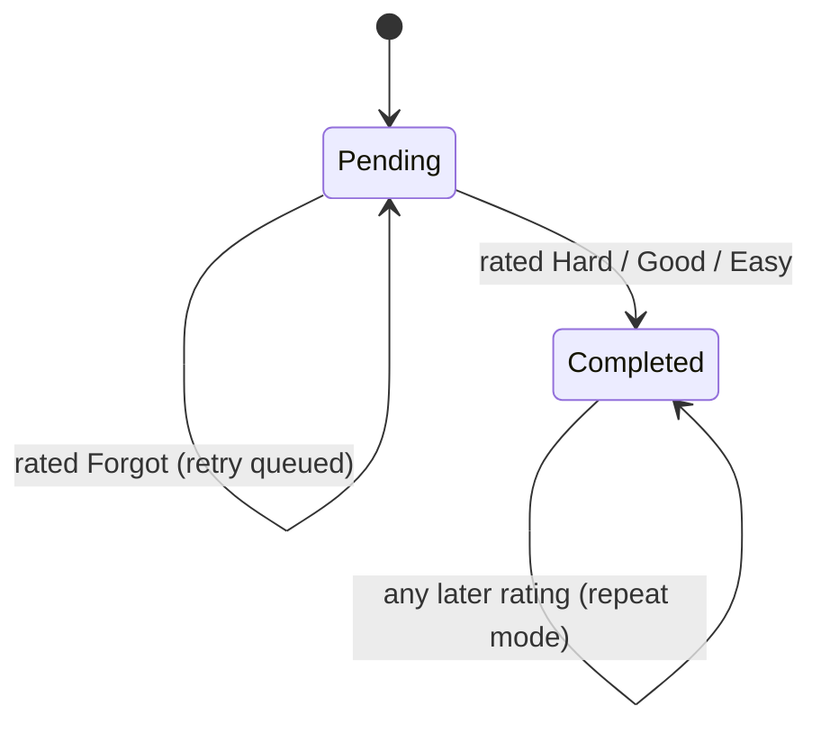

# Data Model: Polished Design Refresh

**Feature**: [spec.md](spec.md) | **Plan**: [plan.md](plan.md)

This feature adds **no server-side entities, tables, columns, endpoints or DTO fields**. `frontend/src/types` stays a mirror of the backend DTOs (constitution IV). The models below are **client-side view models and configuration** derived from existing DTOs, plus one **removal** of local preference data.

---

## 1. Theme tokens (configuration, static)

The single light theme. Exact names and values are in [contracts/design-tokens.md](contracts/design-tokens.md).

| Field group | Contents | Rules |
|---|---|---|
| `colors` (semantic) | canvas, surface, text, textSecondary, textMuted, hairline, divider, controlBorder, controlBorderHover, controlBorderStrong, fill, fillAlt, primary, primaryHover, onPrimary, accent, accentHover, danger, success, warning, focusRing | Static and light-only. There is no mode field. |
| `colors` (legacy aliases) | Old Material-style names mapped to semantic values | Transitional only. Deleted in Polish (SC-008). |
| `stage` | `new`, `learning`, `recognized`, `recalled`, `usable`, `mastered` → ramp hex | The key set equals the stage keys in `StatsSummary.stage_counts` and `learning_stage`. Unknown keys fall back to `new`. |
| `type` | roles `ui`, `display`, `mono` × weights; size scale | Korean selection rule from research R3. |
| `spacing`, `radii`, `controlHeight`, `layout` | Numeric scales; `layout.sidebarWidth = 232`, `layout.contentMaxWidth = 760`, `layout.sidebarMinPageWidth = 720` | Used through tokens, never as literals in screens. |

**Removed**: `ThemeMode`, `ThemeVariation`, `md3Dark`, `visualVariations`, `mode`, `setMode`, `toggleMode`, `variation`, `setVariation`.

---

## 2. Stored local preferences (removal)

| Key | Store | Before | After |
|---|---|---|---|
| `project_pn_theme_mode` | localStorage on web, SecureStore on native | `'light' \| 'dark'` | Deleted once when the theme provider mounts and never read again. |
| `project_pn_theme_variation` | localStorage on web, SecureStore on native | `'bentoIndigo' \| 'bentoSunset' \| 'bentoLight'` | Deleted once when the theme provider mounts and never read again. |

**Transition**: `present → absent`. Cleanup is idempotent, best-effort (errors swallowed) and non-blocking. No other local keys change.

---

## 3. Session progress (derived view model)

Derived by `sessionProgress()` ([contract](contracts/session-progress.md)) from the session's in-memory state. It is never persisted.

| Field | Type | Derivation |
|---|---|---|
| `total` | integer ≥ 1 | `max(dueIds.length, 1)`, where `dueIds` is the set of due items loaded at session start. It is fixed for the session. |
| `completed` | integer, 0…total | The number of distinct ids in `dueIds` with ≥ 1 attempt where `is_correct === true`. |
| `current` | integer, 1…total | `min(completed + 1, total)`. Shown as "current of total". |
| `percent` | integer, 0…100 | `floor(completed / total × 100)`. |

**Inputs**: `attempts: ReviewAttemptParams[]` (existing type, unchanged) and `dueIds: readonly string[]`.

**Correctness rule**: `is_correct = isPassingScore(rating_score)`, with `PASSING_SCORE_THRESHOLD = 0.75` over scores `again 0, hard 1, good 2, easy 3`. The same predicate drives `shouldRetry = !isPassingScore(score)`.

**Per-card state transitions** (within one session):

**Invariants**:
- `completed` is monotonic non-decreasing during a session.
- A Forgot rating never changes `completed`.
- Each due id contributes at most 1 to `completed`.
- `percent === 100` exactly when `completed === dueIds.length` and `dueIds.length > 0`. In normal mode this coincides with queue completion, because failed cards are re-inserted until passed.
- Attempts whose id is not in `dueIds` are ignored.

---

## 4. Today summary (derived view model)

Derived by pure helpers in `features/learn/todaySummary.ts` from `StatsSummary` and `DueItem[]`, both existing DTOs.

| Field | Source | Rule |
|---|---|---|
| `dateLabel` | device clock + app language | Localized weekday, month and day. |
| `due` | `stats.due_today` | — |
| `estimateMinutes` | `due` | `max(1, ceil(due × 30 / 60))`. Hidden when `due === 0`. |
| `mixNote` | `upNext[].learning_stage`, `due` | "all new" / "mostly reviews" / "mix" message key. |
| `xpToday` | `stats.reviews_today × 10` | Same as the current Home. |
| `dailyGoalXp` | `stats.daily_goal_xp` | — |
| `goalPercent` | `xpToday`, `dailyGoalXp` | `min(100, round(xpToday / dailyGoalXp × 100))`. 0 when the goal is 0. |
| `streakDays`, `freezes` | `stats.review_streak_days`, `stats.streak_freeze_tokens` | — |
| `totalWords` | `stats.stage_counts` | Sum of all values. |
| `nextReview` | `stats.forecast` | The first date after today with `count > 0`, else `null` ("none yet"). |
| `upNext` | `getDueLearningItems(5)` | At most 5: lemma, pronunciation, part of speech. |
| `remaining` | `due`, `upNext.length` | `max(0, due − upNext.length)`. Shown as "and N more" when > 0. |
| `mastery` | `stats.stage_counts` | Ramp-ordered segments. An empty track when `totalWords === 0`. |

**States**: `loading` (skeleton, previous data kept when refreshing), `due > 0` (Start review primary), `due === 0 && totalWords > 0` (nothing due; Add a word primary), `totalWords === 0` (new learner empty state), and `error` (existing `ErrorState`).

---

## 5. Daily goal selection (settings view model)

| Field | Rule |
|---|---|
| `presets` | `[100, 200, 300, 500]` |
| `options` | `presets`, plus `saved` when `saved ∉ presets`. The extra option is labeled with its value. |
| `selected` | `saved` (`ReviewSettings.daily_goal_xp`). |
| On select | Optimistically set `selected` and call `patchReviewSettings({ daily_goal_xp })`. On failure, revert to the previous value and show `settings.dailyGoalSaveFailed`. |

Once the learner picks a preset, the custom option disappears on the next render, because `saved` is now a preset.

---

## 6. Navigation shell state (UI state)

| Field | Type | Rule |
|---|---|---|
| `shell` | `'browser' \| 'phone'` | The existing `shellKind(Platform.OS, userAgent)`. |
| `layout` | `'sidebar' \| 'bottom'` | `'sidebar'` when `shell === 'browser'` and `browserPageWidth(window.width) ≥ 720`, else `'bottom'`. |
| `chromeHidden` | boolean | `true` while a review session is active (set by `PracticeScreen`). Both layouts render nothing. |
| `activePair` | string | The active language pair label for the sidebar footer, from existing user-languages data. Display-only. |

---

## 7. Words list filters (UI state)

| Field | Type | Rule |
|---|---|---|
| `deckId` | string \| null | From the deck filter or the `WordsRoot` route param. `null` means all decks. Maps to the existing `deckId` list parameter. |
| `stage` | `'all' \| stage key` | Filter tabs with counts. Applied on the client, as the current `MyWordsScreen` stage filter does. `listLearningItems` has no stage parameter, and none is added. |
| `query` | string | The search field, mapped to the existing `q` parameter. `/` focuses it on keyboard platforms. |

No new API query parameters are introduced.
