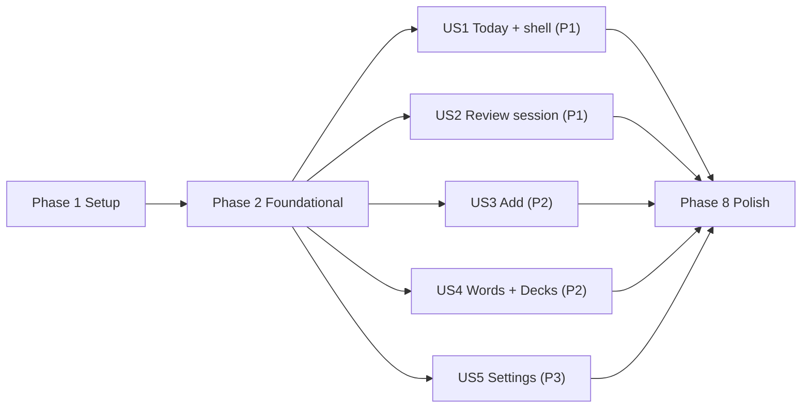

---

description: "Task list for 005 Polished Design Refresh"
---

# Tasks: Polished Design Refresh

**Input**: Design documents from `/specs/005-design-refresh/`

**Prerequisites**: [plan.md](plan.md), [spec.md](spec.md), [research.md](research.md), [data-model.md](data-model.md), [contracts/](contracts/), [quickstart.md](quickstart.md)

**Tests**: Included. The spec requires automated coverage (SC-004 contrast, SC-006 no deleted or skipped tests, SC-011 light-only guard, SC-012 progress vectors), and constitution V requires passing suites. Within each story, write the tests first and confirm they fail before implementing.

**Organization**: Tasks are grouped by user story so that each story can be implemented, tested and shipped on its own after the Foundational phase.

## Format: `[ID] [P?] [Story] Description`

- **[P]**: Can run in parallel (different files, no dependency on an incomplete task)
- **[Story]**: The user story the task belongs to (US1–US5)
- All paths are relative to the repository root. Frontend source lives in `frontend/src/`.

---

## Phase 1: Setup (Shared Infrastructure)

**Purpose**: Dependencies and platform configuration needed before any code change.

- [X] T001 Install the font packages from `frontend/`: `npx expo install @expo-google-fonts/geist @expo-google-fonts/geist-mono @expo-google-fonts/newsreader @expo-google-fonts/ibm-plex-sans-kr`. This updates `frontend/package.json` and the root `package-lock.json`. If a package does not resolve for SDK 56, vendor the SIL OFL `.ttf` files and their license texts into `frontend/assets/fonts/` instead (research R3).
- [X] T002 [P] Set the Tauri window to `"theme": "Light"` in `frontend/src-tauri/tauri.conf.json`, and confirm `"userInterfaceStyle": "light"` in `frontend/app.json` (research R2).

---

## Phase 2: Foundational (Blocking Prerequisites)

**Purpose**: Light-only theme, fonts, restyled primitives, shortcut hook and shell context. Every user story depends on this phase.

**⚠️ CRITICAL**: No user story work can begin until this phase is complete. At the checkpoint, the whole app renders in the new light palette through the legacy alias map, even before any screen is redesigned.

### Tests for Foundational ⚠️

- [X] T003 [P] Rewrite `frontend/src/theme/tokens.test.ts`:
  - Assert every color pair in [research R11](research.md#r11-accessibility-and-contrast) meets its WCAG threshold (4.5:1 text, 3:1 for `controlBorderStrong`, `accent` and `focusRing` against `surface` and `canvas`).
  - Assert the stage key set is exactly `new, learning, recognized, recalled, usable, mastered`, and that `stageColor('unknown')` returns the `new` color.
  - Assert `layout.sidebarMinPageWidth === 720` and `layout.contentMaxWidth === 760`.
- [X] T004 [P] Rewrite `frontend/src/theme/ThemeProvider.test.tsx`:
  - Stored `project_pn_theme_mode` and `project_pn_theme_variation` values are removed on mount and ignored.
  - The context value has no `mode`, `setMode`, `toggleMode`, `variation` or `setVariation`.
  - On web, children render before fonts finish loading.
- [X] T005 [P] Create `frontend/src/theme/lightOnlyGuard.test.ts`. It scans `frontend/src/**/*.{ts,tsx}` (excluding this file) and fails on `md3Dark`, `bento`, `toggleMode`, `setMode(`, `ThemeVariation`, `themeModeStorage`, `themeVariationStorage` or `visualVariations` (SC-011).
- [X] T006 [P] Create `frontend/src/hooks/useKeyboardShortcut.test.ts`:
  - It fires on the bound key.
  - It ignores events while an `INPUT`, `TEXTAREA` or contenteditable element is focused.
  - It respects `enabled: false`.
  - It is a no-op when `Platform.OS !== 'web'`.
  - It unsubscribes on unmount.
- [X] T007 [P] Extend `frontend/src/navigation/shellKind.test.ts` for `shellLayout(shell, windowWidth)`: `'phone'` → `'bottom'`; browser at 719 → `'bottom'`; browser at 720 and 1440 → `'sidebar'`. Use `browserPageWidth` semantics.

### Implementation for Foundational

- [X] T008 Rewrite `frontend/src/theme/tokens.ts` to the [design-tokens contract](contracts/design-tokens.md):
  - Semantic `colors` (`canvas` … `scrim`), `stage` ramp plus `stageColor(key)`, type size tokens, `radii`, `controlHeight`, `layout` and `spacing`.
  - A transitional `legacyAliases` block merged into `colors` per the alias table. Legacy `primary` → `accent`.
  - Delete `md3Light`, `md3Dark`, `ThemeMode`, `semanticColors`, `legacyColors`, `colorsFor(mode)`, `themeFor(mode)` and `visualVariations`. Export a single `theme` object.
- [X] T009 [P] Create `frontend/src/theme/fonts.ts`:
  - Family-name constants (`ui`, `uiMedium`, `uiSemibold`, `display`, `displayMedium`, `mono`, `korean`, `koreanMedium`, `koreanSemibold`).
  - The `useFonts` asset map: Geist 400/500/600, Geist Mono 400, Newsreader 400/500, IBM Plex Sans KR 400/500/600.
  - Web CSS stacks per the contract, registered with `FontDisplay.SWAP`.
  - `containsHangul(text)` using `/[\u1100-\u11FF\u3130-\u318F\uAC00-\uD7AF]/` and `fontFamilyFor(role, weight, { text, lang })`.
- [X] T010 Edit `frontend/src/api/storage.ts`: delete `themeModeStorage`, `themeVariationStorage` and their interfaces. Add `clearLegacyThemePreferences(): Promise<void>`, which removes `project_pn_theme_mode` and `project_pn_theme_variation` from localStorage (web) or SecureStore (native), swallows errors and is idempotent.
- [X] T011 Simplify `frontend/src/theme/ThemeProvider.tsx` (depends on T008–T010):
  - Remove variation and mode state and the storage reads.
  - Call `clearLegacyThemePreferences()` once on mount.
  - Load fonts from `theme/fonts.ts`. On web, render children immediately with the fallback font stacks. On native, keep the current behavior of rendering nothing until fonts are loaded. Add no new dependency (research R3).
  - Context value: `{ ...theme, colors, motion, reduced }`.
- [X] T012 [P] Fix `frontend/App.tsx` to always render `<StatusBar style="dark" />` and drop the `mode` branching at both call sites.
- [X] T013 [P] Add `document.documentElement.style.colorScheme = 'light'` to `frontend/src/webkitStyleFix.web.ts`.
- [X] T014 [P] Remove the dark-mode switch row from `frontend/src/features/profile/ProfileScreen.tsx` (the `mode`/`toggleMode` usage near the Appearance section) and update `frontend/src/features/profile/ProfileScreen.test.tsx` to assert no theme row is rendered.
- [X] T015 [P] Remove the theme toggle action from `frontend/src/features/web/CommandDock.tsx` and update `frontend/src/features/web/CommandDock.test.tsx`.
- [X] T016 [P] Remove the visual-variation picker (`variation`/`setVariation` UI) from `frontend/src/features/learn/HomeScreen.tsx` so it compiles against the new hook. US1 rewrites the screen fully.
- [X] T017 [P] Make `frontend/src/ui/Card.tsx` use `tint="light"` and drop `mode`. Restyle it to `surface` with a `hairline` border, radius `radii.lg` and no shadow.
- [X] T018 Restyle `frontend/src/ui/Text.tsx` (depends on T009):
  - Variants map to the contract size tokens (`heroTitle`, `pageTitle`, `sectionTitle`, `groupLabel`, `body`, `bodySmall`, `caption`, `micro`, `stat`).
  - Add `role?: 'ui' | 'display' | 'mono'`, `lang?: 'ko'` and `tabular?: boolean`.
  - Pick the Korean family when the string children contain Hangul, or when `lang="ko"`.
- [X] T019 [P] Restyle `frontend/src/ui/Button.tsx`:
  - Variants `primary` (`primary` fill, `primaryHover` pressed, `onPrimary` text), `secondary` (outlined `controlBorder`, `fill` hover), `quiet` (transparent, `textSecondary`) and `link` (`accent`).
  - Sizes `md` 40, `lg` 44, `hero` 52.
  - An optional trailing `hint` slot for `Kbd`, a hit area of at least 44, and `focusRing` on web.
- [X] T020 [P] Restyle `frontend/src/ui/Input.tsx`, keeping its existing props (`secureTextEntryToggle`, `loading`, `error`, `helperText`, `onClear`):
  - `controlBorderStrong` border, radius 10, height 44, and a 2 px `focusRing` on focus.
  - Add `variant="display"` (height 52, Newsreader 22) and `leading`/`trailing` slots for the search icon and `Kbd`.
- [X] T021 [P] Restyle `frontend/src/ui/SegmentedControl.tsx`: track `fill` (or `fillAlt` via a `tone="alt"` prop), padding 3, radius 10, segment height 32–34. Selected segment: `surface`, the contract shadow and a `hairline` ring. Use `accessibilityRole` `tablist`/`tab` or `radiogroup`/`radio` via a prop.
- [X] T022 [P] Restyle `frontend/src/ui/Chip.tsx` as a filter tab: height 32, radius 8. Inactive: `textSecondary`, with `fill` on hover. Active: `primary` fill with `onPrimary` text. Optional count at opacity 0.7 with tabular figures. Hit area of at least 44.
- [X] T023 [P] Restyle `frontend/src/ui/Switch.tsx` to 44×26 (off: `controlBorder` track with a `controlBorderStrong` outline; on: `primary`) with a 20 px white knob, and remove the hard-coded colors.
- [X] T024 [P] Restyle `frontend/src/ui/Badge.tsx` with variants `neutral`, `accent`, `success`, `warning` and `danger`, using contract colors and tints.
- [X] T025 [P] Restyle `frontend/src/ui/AnimatedProgressBar.tsx`: `hairline` track, `accent` fill, `height` prop (3 or 4), radius 2, `accessibilityRole="progressbar"` with `accessibilityValue {min, max, now}`. Remove the hard-coded colors.
- [X] T026 [P] Create `frontend/src/ui/Kbd.tsx`: Geist Mono 11, radius 5, 1 px `currentColor` border, opacity 0.65. Render `null` unless `Platform.OS === 'web'` and `shellKind === 'browser'`, and hide it from assistive technology. Export it from `frontend/src/ui/index.ts`.
- [X] T027 [P] Create `frontend/src/ui/SelectableCard.tsx`: `surface`, a 1 px `controlBorder` (hover `controlBorderHover`), radius 12, padding 16. Selected: a `primary` border plus an inset ring. Leading radio indicator; `accessibilityRole="radio"` and `accessibilityState.checked`. Export it from `frontend/src/ui/index.ts`.
- [X] T028 [P] Create `frontend/src/ui/SettingsGroup.tsx`, exporting `SettingsGroup` (optional `title` shown in the `groupLabel` style; card with `surface`, `hairline` border and radius 14) and `SettingsRow` (title, optional subtitle, trailing slot, optional `onPress` with a chevron and `fillSubtle` pressed state, `divider` between rows, `tone="danger"`). Export both from `frontend/src/ui/index.ts`.
- [X] T029 [P] Create `frontend/src/hooks/useKeyboardShortcut.ts` to satisfy T006 ([navigation-shell contract](contracts/navigation-shell.md#keyboard-shortcuts-web-and-tauri-only)).
- [X] T030 Extend `frontend/src/ui/Screen.tsx`:
  - Add `chromeHidden: boolean` and `setChromeHidden(hidden)` to the `TabBarScrollContext` value.
  - Add a `PageColumn` wrapper (`maxWidth: layout.contentMaxWidth`, centered; padding 56/32/80 on wide browser pages and 20 px on phones) and export it.
- [X] T031 Add `SIDEBAR_MIN_PAGE_WIDTH = 720`, `CONTENT_MAX_WIDTH = 760` and `shellLayout(shell, windowWidth): 'sidebar' | 'bottom'` to `frontend/src/navigation/shellKind.ts` to satisfy T007.

**Checkpoint**:
- `npm test -w frontend` and `npm run typecheck -w frontend` pass.
- T005 passes, meaning no dark-mode references remain.
- The app renders entirely light.
- `AddScreen.test.tsx` still passes.

---

## Phase 3: User Story 1 - Today screen and app shell (Priority: P1) 🎯 MVP

**Goal**: A sidebar (desktop) or bottom bar (phone) with five destinations, and a Today screen that shows what's due with one dominant "Start review" action.

**Independent Test**:
- Sign in with due words and compare Today against `design/01-today-desktop.html` (1440 px) and `design/06-today-phone.html` (390 px).
- Press Enter on web to start a review.
- Resize below and above 720 px to see the navigation switch.

### Tests for User Story 1 ⚠️

- [X] T032 [P] [US1] Create `frontend/src/features/learn/todaySummary.test.ts`:
  - `estimateMinutes(16) === 8` and `estimateMinutes(1) === 1`; the estimate is hidden at 0.
  - `totalWords` sums `stage_counts`.
  - `nextReviewAfterToday` returns the first future date with `count > 0`, or `null`.
  - `remaining = max(0, due − upNext.length)`.
  - `goalPercent` caps at 100 and returns 0 when the goal is 0.
  - `mixNote` returns all-new / mostly-reviews / mix.
- [X] T033 [P] [US1] Create `frontend/src/navigation/MainTabs.test.tsx`:
  - A browser shell at 1200 px renders `Sidebar` with items in the order Today, Words, Add, Practice, Settings, the PN mark and the active language-pair label.
  - A browser shell at 600 px and the phone shell render the bottom bar with five items, each at least 44 px.
  - `chromeHidden=true` renders neither layout.
  - The existing testIDs `tab-button-learn` … `tab-button-settings` are present.
- [X] T034 [P] [US1] Rewrite `frontend/src/features/learn/HomeScreen.test.tsx`:
  - The due state shows the headline "16 words are due", the estimate, Start review and Add a word.
  - The glance strip shows goal, streak with freezes, and words with next review.
  - "Up next" renders five items plus "and 11 more".
  - The mastery legend lists six stages with counts.
  - The nothing-due state makes Add a word primary.
  - The zero-words state shows an empty mastery track.
  - On web, Enter navigates to Practice only when due > 0.

### Implementation for User Story 1

- [X] T035 [P] [US1] Create `frontend/src/features/learn/todaySummary.ts` with pure helpers per [data-model §4](data-model.md#4-today-summary-derived-view-model): `estimateMinutes`, `totalWords`, `nextReviewAfterToday`, `remainingCount`, `goalPercent` and `mixNote`, with `XP_PER_REVIEW = 10`.
- [X] T036 [P] [US1] Add i18n keys to both `en` and `ko` in `frontend/src/i18n/translations.ts`: `tabs.today`, `today.headlineDue` ("{count} words are due"), `today.headlineNone`, `today.estimate` ("About {minutes} minutes"), `today.mixAllNew`, `today.mixMostlyReviews`, `today.mixMixed`, `today.startReview`, `today.addWord`, `today.dailyGoal`, `today.streak`, `today.days`, `today.freezesAvailable`, `today.inYourDecks`, `today.words`, `today.nextReview`, `today.nextReviewNone`, `today.upNext`, `today.seeAllWords`, `today.andMore` ("and {count} more"), `today.mastery`, `today.noWordsYet` and `nav.languagePair`.
- [X] T037 [P] [US1] Create `frontend/src/navigation/Sidebar.tsx` per the [sidebar anatomy](contracts/navigation-shell.md#sidebar-anatomy):
  - The PN mark (display 22/500) navigates to `Learn`.
  - Five nav items (36 high, hit area of at least 44, radius 8, `fill` hover and active, `accessibilityState.selected`).
  - A footer showing the active pair from `frontend/src/hooks/useActiveTargetLanguage.ts`.
  - Flex-basis 232 with a `hairline` right border.
- [X] T038 [US1] Update `frontend/src/navigation/MainTabs.tsx` and `frontend/src/navigation/TabSlot.tsx` (depends on T031, T037):
  - Compute `shellLayout` and set `tabBarPosition: 'left'` with `Sidebar` for `'sidebar'`.
  - Otherwise render the restyled bottom bar: items at least 52 high, 22 px icons (home, book, plus, cards, sliders), micro labels, a `hairline` top border, `canvas` background, `text`/`textMuted` states and the bottom safe-area inset.
  - Render nothing when `chromeHidden`.
  - Label the `Learn` route with `t('tabs.today')`, keeping route names and testIDs.
  - Remove the hard-coded colors and the old `tabBarTranslateY` hide logic.
  - Update `frontend/src/navigation/TabSlot.test.tsx` for the restyle.
- [X] T039 [P] [US1] Create `frontend/src/features/learn/MasteryBar.tsx`:
  - A 10 px rounded track (`hairline`) with ramp-ordered segments from `stage_counts`.
  - A legend with 8 px swatches, labels (`home.stage.*`) and tabular counts.
  - `accessibilityRole="image"` with a summarizing label.
  - An empty track and `today.noWordsYet` when the total is 0.
- [X] T040 [US1] Rewrite `frontend/src/features/learn/HomeScreen.tsx` as Today (depends on T035, T036, T039), inside `PageColumn`:
  - Header: date caption, `heroTitle` headline, estimate and mix note, primary hero "Start review" with `Kbd` "Enter", secondary "Add a word".
  - Glance strip: a three-column grid with `hairline` rules, `stat` values, a 4 px goal bar, freezes and next review.
  - "Up next": `getDueLearningItems(5)` from `frontend/src/api/learningItems.ts`, with display-face lemma, mono IPA and POS, followed by "and N more" and "See all words" → Words.
  - `MasteryBar`.
  - States: loading (keep stale data), due, nothing due, new learner, error.
  - Enter shortcut through `useKeyboardShortcut`.
  - Remove the XP orb, gradients, animations and every hard-coded color.
- [X] T041 [US1] Run the US1 tests (T032–T034), `npm run typecheck -w frontend`, and the quickstart scenarios 1–4 at 1440 and 390 px.

**Checkpoint**: US1 is fully functional and testable on its own. This is the MVP.

---

## Phase 4: User Story 2 - Focused review session (Priority: P1)

**Goal**: A distraction-free session with a gloss-only answer, Forgot/Hard/Good/Easy choices showing intervals, and progress that counts correct answers only.

**Independent Test**:
- Start a session with at least 3 cards and complete it keyboard-only (Space, then 1–4) and touch-only at 390 px.
- Fail one card and confirm progress does not move until it is answered correctly.
- Compare against `design/03-practice-answer-desktop.html` and `design/07-practice-phone.html`, ignoring the definition and example lines.

### Tests for User Story 2 ⚠️

- [X] T042 [P] [US2] Update `frontend/src/features/practice/practiceItemState.test.ts`:
  - Add `isPassingScore` cases (0 → false; 1, 2, 3 → true).
  - Add all 11 vectors from [contracts/session-progress.md](contracts/session-progress.md#test-vectors-must-be-encoded-in-practiceitemstatetestts), with vector 8 as the SC-012 case.
  - Remove the `practiceCardProgress` cases. Their unique-card behavior is covered by vectors 2, 4 and 6.
- [X] T043 [P] [US2] Extend `frontend/src/features/practice/PracticeScreen.test.tsx`:
  - Rating Forgot leaves the "{current} of {total}" text and the progress bar value unchanged.
  - A later correct rating of the failed card advances it by exactly one.
  - `setChromeHidden(true)` is called while the session is active, and `false` after "End session" or unmount.
  - Space reveals and 1–4 rate on web.
  - The submitted attempt payload (`is_correct`, `rating_score`) is unchanged for each rating.
- [X] T044 [P] [US2] Extend `frontend/src/features/practice/Flashcard.test.tsx`:
  - The answer side renders only the gloss (no `definition`, no example sentence).
  - A non-empty `personal_note` takes precedence, with the "Your meaning" caption.
  - Long glosses render inside a scroll container.

### Implementation for User Story 2

- [X] T045 [US2] In `frontend/src/features/practice/practiceItemState.ts`, add `PASSING_SCORE_THRESHOLD = 0.75`, `isPassingScore(score)`, `SessionProgressInput`, `SessionProgress` and `sessionProgress()` exactly per the contract (`total = max(distinct dueIds, 1)`, `current = min(completed + 1, total)`, `percent = floor(completed / total × 100)`). Remove `practiceCardProgress`.
- [X] T046 [US2] Rewire progress in `frontend/src/features/practice/PracticeScreen.tsx` (depends on T045):
  - `is_correct: isPassingScore(finalScore)` and `shouldRetry = !isPassingScore(finalScore)`.
  - Replace `practiceCardProgress(...)` and the inline `dueItemsReviewedCount`/`progressPercent` with one `sessionProgress({ attempts, dueIds: dueItems.map(i => i.user_word_sense_id) })` that drives both the bar (`percent`) and the counter (`current`, `total`) in normal and repeat modes.
- [X] T047 [P] [US2] Add i18n keys to both `en` and `ko` in `frontend/src/i18n/translations.ts`: `practice.endSession`, `practice.position` ("{current} of {total}"), `practice.showAnswer`, `practice.rateHint` ("Press 1–4 to rate. Good is the right answer most of the time."), `practice.ratingEasy` (if missing) and `practice.playPronunciation`.
- [X] T048 [US2] Build the focus-mode chrome in `frontend/src/features/practice/PracticeScreen.tsx` (depends on T030, T046):
  - Call `setChromeHidden(true)` while `status === 'active'`, and reset it on status change or unmount.
  - Header in a 760 px column: quiet "End session" button with ✕ (existing end and sync behavior), tabular `practice.position` text, and a 3 px `AnimatedProgressBar`.
  - Remove the tab-bar translate and `setTabBarInteractive` logic and the `bottomBarOffset` compensation that depended on them.
- [X] T049 [US2] Move the PracticeScreen keyboard handler (Space/Enter reveal, 1–4 rate) onto `useKeyboardShortcut` in `frontend/src/features/practice/PracticeScreen.tsx`, keeping its behavior.
- [X] T050 [P] [US2] Restyle `frontend/src/features/practice/Flashcard.tsx`:
  - `surface` card with a `hairline` border, radius 16, padding 48 (phone 32/24).
  - POS caption, display-face lemma 56/400 (phone 44), mono IPA and a round pronunciation button (36 px; 44 px on phones).
  - A `hairline` divider, then the `meaning` 28/500 gloss (phone 24), or the personal note with its caption.
  - Content scrolls inside the capped card.
  - "Show answer" uses primary 48 with `Kbd` "Space".
  - Remove the hard-coded colors. Add no definition or example.
- [X] T051 [P] [US2] Restyle `frontend/src/ui/RatingBar.tsx` and `frontend/src/ui/RatingButton.tsx`:
  - Four choices labeled Forgot, Hard, Good and Easy (`practice.rating*`). Each shows the label, `Kbd` 1–4 and the predicted interval from `preview_intervals`.
  - Desktop: flex-wrapping, flex-basis 140, radius 12, `surface` with `controlBorder`; Good uses the `primary` fill.
  - Phone: a four-column grid with a minimum height of 60, pinned below the card.
  - Show the `practice.rateHint` caption on keyboard platforms.
  - Remove the hard-coded colors.
- [X] T052 [US2] Restyle the session states in `frontend/src/features/practice/PracticeScreen.tsx`: Retrying (`warning`) and Stuck (`danger`) badges, the "Change meaning" quiet action under revealed leech cards, the no-due state, the session-complete summary (XP earned, Stuck words with Change meaning and Write my meaning), and the sync-failure and retry states. Use tokens and the new primitives only.
- [X] T053 [P] [US2] Update the Practice UX section of `frontend/docs/frontend-ux-patterns.md`:
  - Session progress counts distinct due cards answered correctly (Hard, Good or Easy) and never advances on Forgot.
  - The counter and the bar share `sessionProgress()`.
  - Navigation chrome is hidden during sessions.
- [X] T054 [US2] Run the US2 tests (T042–T044), `npm run typecheck -w frontend`, and the quickstart scenarios 5–9.

**Checkpoint**: US1 and US2 both work independently.

---

## Phase 5: User Story 3 - Add a word (Priority: P2)

**Goal**: The redesigned Add screen with Manual-first preserved, a large serif input, an optional context disclosure and gloss-only meaning cards.

**Independent Test**: With a deck selected, the word input is visible on first paint. Look up "resilient", pick a meaning and add it, then confirm it appears in Words. Compare against `design/04-add-desktop.html`, ignoring the definition and example lines.

### Tests for User Story 3 ⚠️

- [X] T055 [P] [US3] Update `frontend/src/navigation/AddScreen.test.tsx`:
  - Change the visible-label assertions from "Manual Add" to "Word or phrase", and "From a passage" where applicable.
  - Keep the assertions that the `tab-manual` segment is first and selected by default, and that `manual-add-input-wrapper` is visible on first paint (Manual-first CI gate, SC-006).
  - Assert the header shows "Add a word" and "Adding to {deck}".
- [X] T056 [P] [US3] Update `frontend/src/components/SensePicker.test.tsx`:
  - Options render the simple gloss plus POS and CEFR labels.
  - No example sentence or English definition is rendered.
  - The "Closest to your sentence" badge still marks the ranked option.
  - The found count, "None of these — search again" (`force: true`) and "Add to deck" work.
- [X] T057 [P] [US3] Update `frontend/src/features/add/ManualAddSection.test.tsx`:
  - "Add context" is collapsed by default.
  - Expanding it shows "Where you saw it", "Your own wording" and "Part of speech", mapping to `source_context`, the personal note and the POS filter.
  - Enter and "Find meanings" trigger lookup with the existing loading state.

### Implementation for User Story 3

- [X] T058 [P] [US3] Add or update i18n keys in both `en` and `ko` in `frontend/src/i18n/translations.ts`: `add.manual` → "Word or phrase" / "단어 또는 구문", `add.passage` → "From a passage", `add.title`, `add.addingTo`, `add.inputPlaceholder`, `add.findMeanings`, `add.addContext`, `add.addContextHint`, `add.whereSaw`, `add.whereSawPlaceholder`, `add.ownWording`, `add.ownWordingPlaceholder`, `add.partOfSpeech`, `add.whichMeaning`, `add.foundCount` and `add.noneSearchAgain`.
- [X] T059 [US3] Restyle the header and switcher in `frontend/src/navigation/AddScreen.tsx` inside `PageColumn`: `pageTitle` "Add a word", an "Adding to {deck}" caption with the inline deck control, and a right-aligned `SegmentedControl` (manual first). Keep `useState<'passage' | 'manual'>('manual')`, `testID="tab-manual"` and the current tab logic unchanged.
- [X] T060 [P] [US3] Restyle `frontend/src/features/add/TargetDeckSelector.tsx` as an inline, underlined, medium-weight text button that opens the existing deck picker. If the picker is a bottom sheet, its surface keeps `PAGE_WIDTH_FRAME` and `testID="bottom-sheet"`. Update `frontend/src/features/add/TargetDeckSelector.test.tsx` if selectors change.
- [X] T061 [US3] Restyle `frontend/src/features/add/ManualAddSection.tsx` (depends on T020, T026):
  - Shared `Input` with `variant="display"` and the placeholder "A word or phrase, e.g. look up", next to a primary hero "Find meanings" button with `Kbd` "Enter".
  - A collapsible "Add context — optional" disclosure (chevron, collapsed by default) containing a grid of shared `Input`s for source context (full width) and own wording, plus the existing `PosSelector`.
  - Keep the `manual-add-input-wrapper` testID and all existing behavior.
- [X] T062 [US3] Rework `frontend/src/components/SensePicker.tsx` (depends on T027):
  - The `sectionTitle` "Which meaning did you mean?" with an "{n} found" caption.
  - A `radiogroup` of `SelectableCard`s, each showing `displayGloss(...)` at 17/500 plus "POS · CEFR" caption labels.
  - Remove the example sentence line.
  - Keep the "Closest to your sentence" badge (`Badge variant="accent"`).
  - Footer: a link button "None of these — search again" and a primary "Add to deck" (height 44).
  - Remove the hard-coded colors.
- [X] T063 [P] [US3] Restyle `frontend/src/features/add/CaptureSection.tsx` and `frontend/src/components/TappablePassage.tsx` with tokens only, keeping the two-tap phrase selection and the undo-on-clear behavior.
- [X] T064 [US3] Run the US3 tests (T055–T057), `rg "useState<'passage' \| 'manual'>" frontend/src/navigation/AddScreen.tsx` (expect `'manual'`), `npm test -w frontend -- --testPathPattern=AddScreen`, and the quickstart scenarios 10–11.

**Checkpoint**: US3 works on its own, and the Manual-first gate is green.

---

## Phase 6: User Story 4 - Words library (Priority: P2)

**Goal**: A table-like word list with search, stage tabs and a deck filter, plus a separate Decks view opened from the filter menu.

**Independent Test**:
- With 16 words, search "late" → "latency"; filter "New".
- Move a word to another deck from its row.
- Open Decks from the filter, rename a deck, and open it to return filtered.
- Compare against `design/02-words-desktop.html`.

### Tests for User Story 4 ⚠️

- [X] T065 [P] [US4] Update `frontend/src/features/words/MyWordsScreen.test.tsx`:
  - The header shows "{n} words in {m} decks", the deck filter and "New deck".
  - Stage tabs show All plus six stages with counts, and the active tab has `accessibilityState.selected`.
  - On web, `/` focuses search.
  - A `deckId` route param preselects the deck.
  - The deck filter's "Manage decks" navigates to `Decks`.
  - The inline `DeckCanvas` is no longer rendered.
  - At page widths below 720, rows render only the word and stage.
  - Choosing remove on a row, or bulk-removing selected words, opens the confirmation dialog. Cancel leaves the list unchanged and does not call `archiveLearningItem` or `archiveLearningItems`. Remove calls the matching archive function once with the right ids. The bulk dialog states the count (FR-028a).
- [X] T066 [P] [US4] Create `frontend/src/features/words/DecksScreen.test.tsx`:
  - It lists decks with word counts.
  - Opening a deck navigates to `WordsRoot` with `{ deckId }`.
  - Rename calls `renameDeck`.
  - Delete is unavailable for the default deck and calls `deleteDeck` for others.
  - Create calls `createDeck`.
- [X] T067 [P] [US4] Add the `DeckFilterMenu` phone bottom sheet (`testID="bottom-sheet"`) to `frontend/src/components/bottomSheetWidth.test.tsx`.
- [X] T068 [P] [US4] Create `frontend/src/ui/ConfirmDialog.test.tsx`:
  - It renders the title, the body, a Cancel button and a danger-styled confirm button.
  - Confirm calls `onConfirm` exactly once.
  - Cancel, the backdrop and (on web) Escape call `onCancel` and not `onConfirm`.
  - It renders nothing when `visible` is false.
  - Its surface (`testID="confirm-dialog"`) uses `PAGE_WIDTH_FRAME`. Add this surface to `frontend/src/components/bottomSheetWidth.test.tsx` as well (`DESIGN.md` overlay rule).

### Implementation for User Story 4

- [X] T069 [P] [US4] Add i18n keys to both `en` and `ko` in `frontend/src/i18n/translations.ts`: `words.title`, `words.summary` ("{words} words in {decks} decks"), `words.allDecks`, `words.newDeck`, `words.manageDecks`, `words.searchPlaceholder` ("Search words or meanings"), `words.colWord`, `words.colMeaning`, `words.colType`, `words.colStage`, `words.colDue`, `words.dueToday`, `words.rowHint`, `words.decksTitle`, `words.openDeck`, `words.removeConfirmTitle` ("Remove this word?" / "이 단어를 삭제할까요?"), `words.removeConfirmTitleMany` ("Remove {count} words?" / "단어 {count}개를 삭제할까요?"), `words.removeConfirmBody` ("This can't be undone." / "이 작업은 되돌릴 수 없습니다.") and `words.removeConfirmAction` ("Remove" / "삭제"). Reuse the existing `common.cancel`.
- [X] T070 [P] [US4] Create `frontend/src/ui/ConfirmDialog.tsx` and export it from `frontend/src/ui/index.ts` (satisfies T068):
  - Props: `visible`, `title`, `body`, `confirmLabel`, `cancelLabel`, `tone: 'danger' | 'default'`, `onConfirm` and `onCancel`.
  - An in-app React Native `Modal` (not `Alert.alert`, which does nothing on react-native-web), with a full-window `scrim` backdrop and a `surface` card (radius 14, padding 24) that spreads `PAGE_WIDTH_FRAME` and caps its own width at 400.
  - The title uses `sectionTitle` and the body uses `body`/`textSecondary`. Buttons: a `secondary` Cancel and a confirm button with a `danger` fill when `tone="danger"`, each at least 44 px.
  - Cancel is the default focus on web. Escape and backdrop presses cancel. Use `accessibilityRole="alert"` (or `aria-modal`) on the surface.
- [X] T071 [US4] Update `frontend/src/navigation/WordsStack.tsx`: set `WordsStackParamList` to `WordsRoot: { deckId?: string } | undefined`, `WordDetail: …existing` and `Decks: undefined`, and register the `Decks` route with `DecksScreen`. Keep the existing route names and linking.
- [X] T072 [P] [US4] Create `frontend/src/features/words/DeckFilterMenu.tsx`:
  - Items: "All decks", each deck with its count, a separator, "New deck" (opens `DeckFormModal` in create mode) and "Manage decks" (navigates to `Decks`).
  - On the phone shell it is a bottom sheet with `PAGE_WIDTH_FRAME` and `testID="bottom-sheet"`; on the browser shell it is an anchored menu.
  - Its trigger is a secondary button showing the current deck name and a chevron.
- [X] T073 [US4] Create `frontend/src/features/words/DecksScreen.tsx` (depends on T071):
  - Move the deck management state and handlers out of `MyWordsScreen.tsx` (deck list loading, multi-select, create, rename, delete non-default through `DeckFormModal`, `deckCounts.ts`) and host `DeckCanvas`/`DeckList`.
  - Opening a deck calls `navigation.navigate('WordsRoot', { deckId })`.
  - Use `pageTitle` "Decks" in `PageColumn`.
- [X] T074 [US4] Rework `frontend/src/features/words/MyWordsScreen.tsx` (depends on T072, T073, T070) inside `PageColumn`:
  - Remove the inline `DeckCanvas` and its management handlers.
  - Header: `pageTitle`, summary, `DeckFilterMenu`, "New deck".
  - Search: the shared `Input` with a search icon and `Kbd` "/", plus the `/` shortcut through `useKeyboardShortcut`.
  - Stage filter tabs using `Chip` with counts (client-side filtering, as today).
  - A table header and rows on a responsive grid: Word (display 20) + IPA (mono 12), Meaning, Type, Stage (8 px `stageColor` swatch plus label), Due (right-aligned). Below 720 px only Word and Stage show.
  - Rows navigate to `WordDetail`. Pointer devices get `HoverReveal` actions: `SpeakButton`, move via `MoveToDeckModal`, and remove.
  - Remove (FR-028a): both the row action (currently `handleRemoveItems([item.id])`) and bulk removal (currently `handleRemoveItems(Array.from(selectedItemIds))`) first open `ConfirmDialog` with `tone="danger"`, using `words.removeConfirmTitle` (or `words.removeConfirmTitleMany` with the count), `words.removeConfirmBody`, `words.removeConfirmAction` and `common.cancel`. `handleRemoveItems` runs only from `onConfirm`, and Cancel closes the dialog with no other effect.
  - The footer hint is `words.rowHint`.
  - Honor the `deckId` route param.
  - Keep pagination (`scrollPagination.ts`) and `useLearningItems` behavior.
- [X] T075 [P] [US4] Make sure `frontend/src/features/words/WordDetailScreen.tsx` exposes audio, move to deck and remove for touch devices, and restyle it with tokens. Its remove action uses the same `ConfirmDialog` guard as T074 before archiving (depends on T070). Update `frontend/src/features/words/WordDetailScreen.test.tsx` to assert that Cancel does not archive and Remove archives once.
- [X] T076 [P] [US4] Restyle `frontend/src/features/words/DeckCanvas.tsx`, `DeckList.tsx`, `DeckFormModal.tsx` and `MoveToDeckModal.tsx` with tokens, the new `Button`/`Input` and `SettingsGroup`-like rows, removing their hard-coded colors. Sheets keep `PAGE_WIDTH_FRAME`.
- [X] T077 [US4] Run the US4 tests (T065–T068), `npm run typecheck -w frontend`, and the quickstart scenarios 12–13 and 20.

**Checkpoint**: US4 works on its own, and Decks is reachable only from the filter.

---

## Phase 7: User Story 5 - Settings (Priority: P3)

**Goal**: Grouped settings that save on change, daily goal presets that preserve a custom value, and no theme setting.

**Independent Test**: Change the goal, retention, vacation mode and app language, then reload. Every value persists and there is no Theme row. Compare against `design/05-settings-desktop.html`, ignoring its Theme row.

### Tests for User Story 5 ⚠️

- [X] T078 [P] [US5] Create `frontend/src/features/profile/dailyGoal.test.ts`: `goalOptions(200)` returns `[100, 200, 300, 500]`, `goalOptions(250)` returns `[100, 200, 250, 300, 500]` (sorted, with 250 marked custom), and `goalOptions(500)` adds nothing.
- [X] T079 [P] [US5] Extend `frontend/src/features/profile/ProfileScreen.test.tsx`:
  - Groups render in the order Account, Review, Streak, Appearance, then Help/About/Log out.
  - Selecting 300 calls `patchReviewSettings({ daily_goal_xp: 300 })`.
  - A saved goal of 250 shows a selected "250" option.
  - A failed save reverts the selection and shows `settings.dailyGoalSaveFailed` inline.
  - The retention slider shows a percentage and saves.
  - The vacation switch toggles.
  - Appearance contains only the app language.
  - Log out uses the danger tone.

### Implementation for User Story 5

- [X] T080 [P] [US5] Create `frontend/src/features/profile/dailyGoal.ts` with `GOAL_PRESETS = [100, 200, 300, 500]` and `goalOptions(saved): { value, custom }[]`. Per [data-model §5](data-model.md#5-daily-goal-selection-settings-view-model): "`presets`, plus `saved` when `saved ∉ presets`", sorted ascending.
- [X] T081 [P] [US5] Add i18n keys to both `en` and `ko` in `frontend/src/i18n/translations.ts`: `settings.title`, `settings.autosaveNote` ("Changes save as you make them."), `settings.groupAccount`, `settings.groupReview`, `settings.groupStreak`, `settings.groupAppearance`, `settings.email`, `settings.connectedAccounts`, `settings.languagePairs`, `settings.dailyGoalSubtitle` ("10 XP per review"), `settings.retentionSubtitle`, `settings.vacationSubtitle` ("Pause your streak for up to 7 days"), `settings.freezeSubtitle` ("{count} available · covers one missed day"), `settings.useFreeze`, `settings.appLanguage`, `settings.help`, `settings.about` and `settings.logOut`. Reuse the existing `settings.desiredRetention*`, `settings.dailyGoal*` and `settings.vacationMode*` keys where they fit.
- [X] T082 [US5] Restructure `frontend/src/features/profile/ProfileScreen.tsx` with `SettingsGroup` and `SettingsRow` inside `PageColumn` (depends on T028, T080):
  - **Account**: email, Connected accounts → `ConnectedAccountsScreen`, Language pairs → `LanguagePairsScreen` (showing the active pair).
  - **Review**: a daily goal `SegmentedControl tone="alt"` over `goalOptions`, with optimistic save and revert on error; a desired retention slider (70–97) showing a tabular percentage, saving on release.
  - **Streak**: a vacation mode `Switch` and a "Use freeze" secondary small button with the available count.
  - **Appearance**: an app language select only.
  - **Final group**: Help and feedback and About with the version (hidden if there is no destination), and Log out (`tone="danger"`).
  - Show the autosave note under the title.
  - Remove the free-text goal input.
- [X] T083 [P] [US5] Restyle `frontend/src/features/profile/LanguagePairsScreen.tsx`, `AddLanguagePairScreen.tsx`, `EditLanguagePairScreen.tsx` and `ConnectedAccountsScreen.tsx` with `SettingsGroup`/`SettingsRow` and tokens. Update `frontend/src/features/profile/EditLanguagePairScreen.test.tsx` if selectors change.
- [X] T084 [US5] Run the US5 tests (T078–T079), `npm run typecheck -w frontend`, and the quickstart scenarios 14–15.

**Checkpoint**: All five user stories work on their own.

---

## Phase 8: Polish & Cross-Cutting Concerns

**Purpose**: Restyle the screens the boards don't show, remove the transitional alias layer, update the docs, and verify.

- [X] T085 [P] Restyle the sign-in and onboarding screens with tokens and the new primitives: `frontend/src/screens/CentralAuthScreen.tsx`, `frontend/src/screens/OnboardingScreen.tsx`, `frontend/src/screens/ManualAddScreen.tsx`, `frontend/src/features/auth/AccountMergeScreen.tsx` and `frontend/src/features/auth/GuestBanner.tsx`. Update the matching tests only where selectors change.
- [X] T086 [P] Restyle the import screens `frontend/src/features/import/AnkiImportScreen.tsx` and `frontend/src/features/import/ImportConflictPicker.tsx` with tokens.
- [X] T087 [P] Restyle the shared states and overlays with tokens and remove their hard-coded colors: `frontend/src/ui/EmptyState.tsx`, `ErrorState.tsx`, `LoadingState.tsx`, `SkeletonCard.tsx`, `ContextualCommandBar.tsx`, `CinematicCard.tsx`, `frontend/src/components/QueueBanner.tsx`, `frontend/src/features/words/ChangeMeaningSheet.tsx`, `frontend/src/features/web/InspectorPanel.tsx` and `frontend/src/features/web/CommandDock.tsx`.
- [X] T088 [P] Retune `frontend/src/components/Confetti.tsx` to use the stage ramp and accent colors from tokens. It is the only allowlisted file for literal colors, if needed.
- [X] T089 Migrate every remaining legacy alias usage (`colors.primary` as brand, `outlineVariant`, `surfaceContainer*`, `onSurface*`, `primaryContainer`, `secondaryContainer`, `tertiary*`, `inverse*`, `accent2`, `surfaceGlass`, `borderGlass`, and so on) across `frontend/src/**` to the semantic tokens. Then delete the `legacyAliases` block from `frontend/src/theme/tokens.ts` (depends on all stories).
- [X] T090 Extend `frontend/src/theme/lightOnlyGuard.test.ts` with the SC-008 check: no raw `#hex` or `rgba(` literals in `frontend/src/**/*.{ts,tsx}` outside `frontend/src/theme/` (allowlist `components/Confetti.tsx` and test files), and no references to the removed legacy alias names (depends on T089).
- [X] T091 Remove `@expo-google-fonts/inter` from `frontend/package.json` and delete any remaining `Inter-*` references (`frontend/src/ui/Text.tsx` and `frontend/src/theme/*`). Confirm with `rg -n "Inter-|expo-google-fonts/inter" frontend/src` returning nothing.
- [X] T092 [P] Update `DESIGN.md`:
  - Add a "Visual system" section covering the light-only theme, token roles, the stage ramp, the three type roles, radii and the R11 border rule.
  - Add a "Navigation shell" section covering the 720 px sidebar/bottom switch, the 760 px content column and chrome hiding in sessions.
  - State that the overlay width rule now covers the sidebar layout (the `BrowserFrame` page includes the sidebar).
- [X] T093 [P] Update `frontend/docs/frontend-ux-patterns.md`:
  - The Add tab's manual segment is labeled "Word or phrase", and the invariant is unchanged.
  - Sense picker options show the gloss with POS and CEFR labels, and no example.
  - Add a keyboard shortcuts table (Enter, `/`, Space, 1–4) with `Kbd` chips on keyboard platforms only.
  - The app is light-only.
  - Destructive actions section: local-only actions (for example clearing a passage) keep the undo pattern. Removing a word changes server data and can't be undone in the app, so it uses the shared `ConfirmDialog` guard ("Remove this word? This can't be undone.").
- [X] T094 Create `specs/005-design-refresh/checklists/capability-inventory.md`, listing every pre-redesign capability (decks, deck view, phrases, passage capture, personal meanings, change meaning, repeat review, streak freeze, vacation mode, language pairs, connected accounts, import, log out) with where each is reached after the redesign. Verify each item by hand (SC-010).
- [X] T095 Run the remaining quickstart scenarios 16–21 (OS dark mode, stale preference, Korean UI, slow fonts, overlays, Tauri 1000×720). Do the full visual review at 1440×960 and 390×844 against `specs/005-design-refresh/design/*.html` using the `local-ui-verify` workflow, and record any deviations in the PR description (SC-001).
- [X] T096 Run `npm run verify:full` (lint, typecheck, `npm test -w frontend`, `npm test -w packages/api`, serial backend tests) and confirm no tests were skipped, and that tests were deleted only for code this plan intentionally removes (the old `practiceCardProgress` cases in T042), each replaced by new coverage (SC-006). Paste the Add-tab merge checklist from `GEMINI.md` into the PR body.

---

## Dependencies & Execution Order

### Phase Dependencies

- **Setup (Phase 1)**: no dependencies.
- **Foundational (Phase 2)**: depends on Setup (T001 for fonts). **Blocks every user story.**
- **US1 (Phase 3)** and **US2 (Phase 4)**, both P1, can start after Foundational and run in parallel.
- **US3 (Phase 5)** and **US4 (Phase 6)**, both P2, can start after Foundational. They are independent of US1 and US2.
- **US5 (Phase 7)**, P3, can start after Foundational. It shares `ProfileScreen.tsx` with T014, which is already done in Foundational.
- **Polish (Phase 8)**: T085–T088 can start any time after Foundational. T089–T091 and T094–T096 need every story finished.

### User Story Dependencies



- No story depends on another story. Shared touchpoints are limited to `frontend/src/i18n/translations.ts`, where each story adds its own key block (T036, T047, T058, T069, T081). Serialize edits to that file, or merge carefully, when stories run in parallel.
- US2's chrome hiding (T048) uses the `setChromeHidden` context from Foundational (T030), not US1's `Sidebar`. On its own it hides the existing bottom bar. Once US1 lands, it hides the sidebar too.

### Within Each User Story

- Write the tests first and confirm they fail.
- Pure helpers (`todaySummary.ts`, `sessionProgress`, `dailyGoal.ts`) come before the screens that use them.
- i18n keys come before the screens that render them.
- Screen integration comes before the story's validation task.

### Parallel Opportunities

- Setup: T002 runs alongside T001.
- Foundational: tests T003–T007 run together; T009, T012–T017, T019–T029 are in different files and can run in parallel after T008. T011 needs T008–T010, T018 needs T009, and T030 and T031 are independent.
- Across stories: after Foundational, US1–US5 can be worked by different people at once.
- Polish: T085–T088 and T092–T093 run in parallel.

---

## Parallel Example: User Story 1

```bash
# Tests first (all different files):
Task: "T032 todaySummary.test.ts in frontend/src/features/learn/"
Task: "T033 MainTabs.test.tsx in frontend/src/navigation/"
Task: "T034 HomeScreen.test.tsx rewrite in frontend/src/features/learn/"

# Then independent building blocks:
Task: "T035 todaySummary.ts"
Task: "T036 i18n keys (tabs.today, today.*)"
Task: "T037 Sidebar.tsx"
Task: "T039 MasteryBar.tsx"

# Then integration (sequential):
Task: "T038 MainTabs.tsx + TabSlot.tsx"
Task: "T040 HomeScreen.tsx rewrite"
```

## Parallel Example: User Story 2

```bash
Task: "T042 practiceItemState.test.ts vectors"
Task: "T043 PracticeScreen.test.tsx progress + chrome"
Task: "T044 Flashcard.test.tsx gloss-only"
# then
Task: "T045 sessionProgress() in practiceItemState.ts"
Task: "T050 Flashcard.tsx restyle"
Task: "T051 RatingBar.tsx + RatingButton.tsx restyle"
# then sequential edits to PracticeScreen.tsx: T046 → T048 → T049 → T052
```

---

## Implementation Strategy

### MVP First (User Story 1 Only)

1. Phase 1 Setup (T001–T002).
2. Phase 2 Foundational (T003–T031). The app is now light-only with new fonts and primitives.
3. Phase 3 US1 (T032–T041), the new shell and Today.
4. **Stop and validate** with the quickstart scenarios 1–4, then demo or deploy.

### Incremental Delivery

1. Foundation, then US1 (MVP), then US2, which also fixes the progress logic the user called out. Consider shipping US2 right after the MVP.
2. Next, US3 (Add) and US4 (Words + Decks).
3. Next, US5 (Settings).
4. Finally, Polish: alias removal, docs and full verification.

Each increment passes `npm test -w frontend` and the typecheck on its own, and leaves the Manual-first gate green.

### Parallel Team Strategy

After Foundational, these can run in parallel:
- Developer A: US1, then Polish T085–T088.
- Developer B: US2.
- Developer C: US3, then US5.
- Developer D: US4.

Coordinate edits to `translations.ts`.

---

## Notes

- `[P]` means different files with no dependency on incomplete tasks. `[USn]` maps the task to its spec story.
- Never weaken `AddScreen.test.tsx`. Only the visible label assertion changes, and the `tab-manual` and `manual-add-input-wrapper` checks stay.
- `review_attempts` payloads must stay unchanged (constitution II). T043 asserts this.
- Commit after each task or logical group, and stop at any checkpoint to validate a story on its own.
